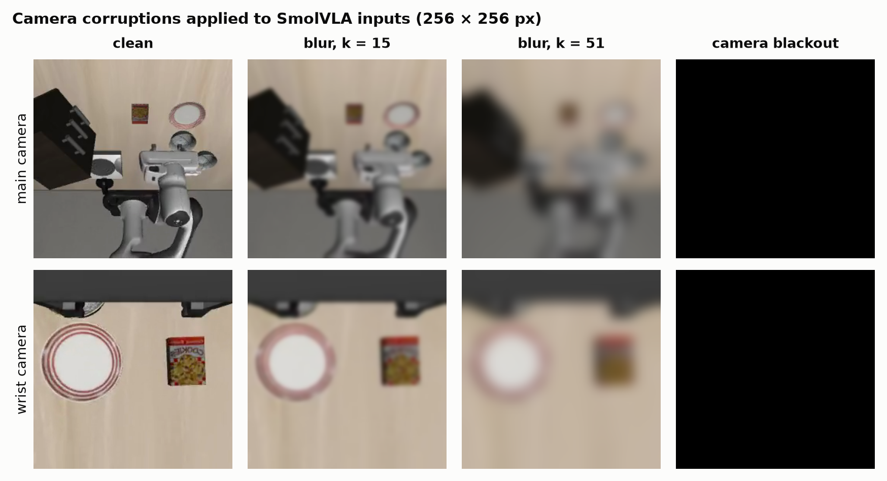
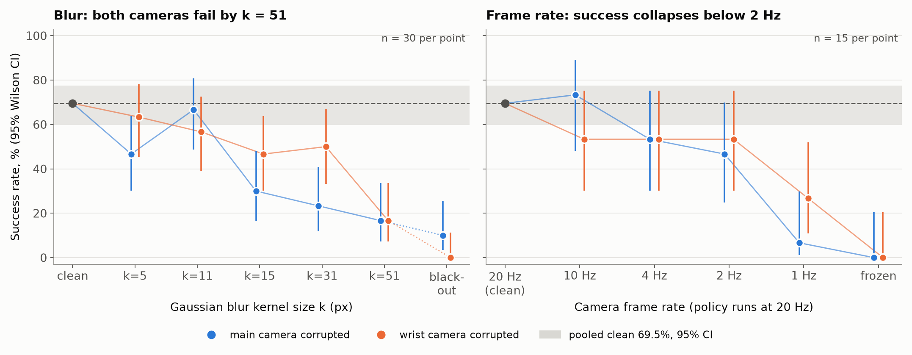
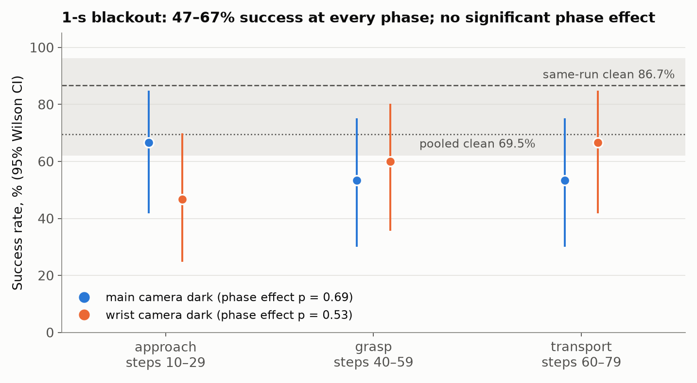
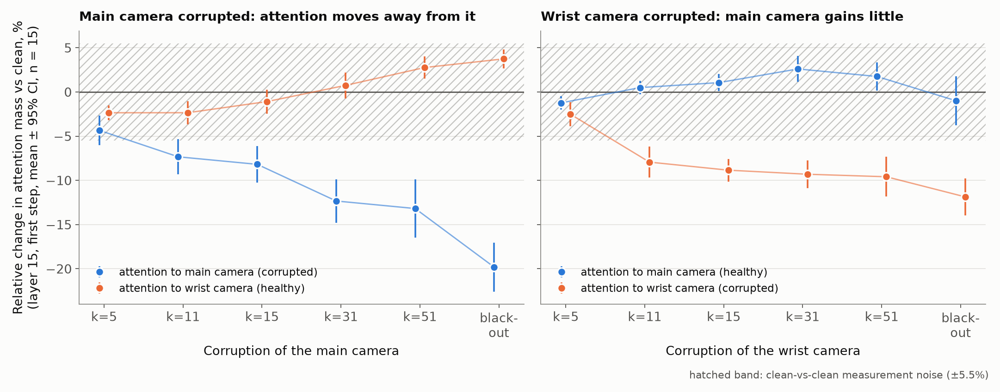
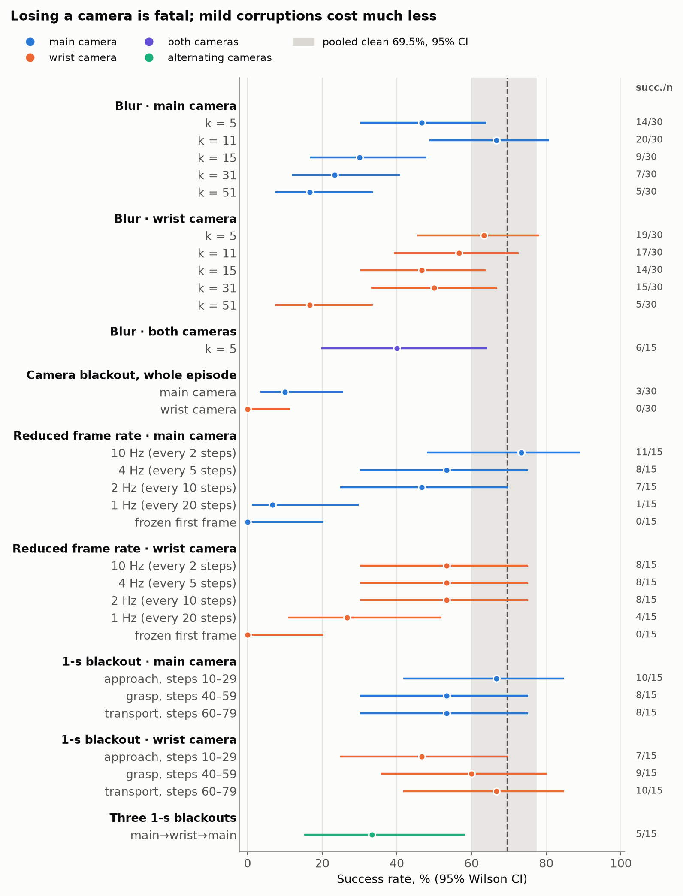

# BlindRobot: How Vision Failures Affect Robotic Intelligence

**Team:** Daniia Zinniatullina, Dmitrij Kosenkov, Ruslan Ziyazetdinov

Vision-language-action (VLA) policies control robots from camera images, and real cameras fail: they blur, freeze or
go dark. We test how the pretrained **SmolVLA** policy, which sees the scene through a main camera and a wrist camera,
copes when one of these cameras is blurred, blacked out or updated at a reduced frame rate. We also check whether the
policy shifts its attention to the healthy camera. On five LIBERO-Spatial tasks (clean success 69.5%), losing either
camera for a whole episode reduces success to 0–10%, and strong blur or a 1 Hz frame rate is almost as harmful. A
1-second blackout costs much less. Attention moves away from a corrupted camera but barely towards the healthy one,
so the policy does not use its two views redundantly.



## Research questions

1. How much does SmolVLA's success drop when one camera is blurred, blacked out, or updated at a reduced frame rate?
2. Is the main camera or the wrist camera more critical?
3. Does it matter *when* during the task a camera goes dark?
4. Does the policy move its attention to the healthy camera when the other one degrades?

## Setup

**Policy.** [`HuggingFaceVLA/smolvla_libero`](https://huggingface.co/HuggingFaceVLA/smolvla_libero), used without
fine-tuning. SmolVLA is a vision-language model plus a flow-matching *action expert*: from two camera images, the robot
state and a text instruction it predicts robot actions at 20 Hz.

**Cameras.** The **main camera** is a fixed third-person view of the table (`image`, suffix `_0` in condition names).
The **wrist camera** is mounted on the gripper (`image2`, suffix `_1`). Both are 256 × 256 px.

**Tasks.** LIBERO-Spatial tasks 0–4 (pick up the black bowl at a given location and place it on the plate), seeds 42,
43 and 44. An episode is a **success** if the task is completed within **140 policy steps** (7 s).

**Runs.** Each experiment batch (*run*) evaluates every condition on the 15 (task, seed) pairs and re-evaluates its own
15 clean episodes. Seven runs give 105 clean episodes in total. Blur and whole-episode blackout were run twice, so they
have 30 episodes per condition (the same 15 starts evaluated twice); all other conditions have 15.

**Corruptions** (applied to one camera before preprocessing, see [`src/corruptions.py`](src/corruptions.py)):

| Corruption | Condition name | What the policy sees |
|---|---|---|
| Blur | `blur_K_C` | `cv2.GaussianBlur` with a K × K kernel (K = 5, 11, 15, 31, 51 px) at every step; `blur_5_0_1` blurs both cameras |
| Camera blackout | `turnoff_C` | black frames for the whole episode |
| Reduced frame rate | `freeze_P_C` | the camera is refreshed only every P steps (P = 2, 5, 10, 20 → 10, 4, 2, 1 Hz); the last frame is repeated in between |
| Frozen first frame | `freeze_140_C` | the first frame is shown for the whole episode |
| 1-s blackout | `off_<phase>_C` | black frames for 20 steps during approach (steps 10–29), grasp (40–59) or transport (60–79) |
| Three 1-s blackouts | `off_mix_A_B_C` | black frames at steps 10–29, 40–59 and 80–99 on cameras A, B, C |

**Statistics.** Success rates are reported with 95% **Wilson confidence intervals** (CI), which stay accurate for small
samples. Differences are in **percentage points (pp)**. Each condition is compared with clean using a two-sided Fisher
exact test, with **Holm correction** for multiple comparisons (30 tests against the pooled clean baseline).

**Attention.** During the second blur/blackout run we recorded the **attention mass** of the action expert's
cross-attention on each camera: the share of attention placed on that camera's image tokens, averaged over heads and
denoising steps, at the first step of every episode. We report its **relative change** vs the clean episode with the
same start.

## Results

The full analysis, with all tables and tests, is in [`notebooks/analysis.ipynb`](notebooks/analysis.ipynb).

### 1. The clean baseline is noisy, so we pool it

Clean success varies between 53% and 87% across the seven runs, although every run uses the same 15 (task, seed)
pairs. This spread is consistent with chance (χ² test, p = 0.34): 10 of the 15 pairs succeed in some runs and fail in
others. We therefore compare every condition with the **pooled clean baseline of 69.5%** (73/105, 95% CI 60–78%).
With this sample size, only drops of about **40 pp or more** remain significant after Holm correction; smaller
differences are trends.

Clean success is below the ≈90% reported for SmolVLA on LIBERO-Spatial because of the 140-step limit: no task is solved
before step ~70, and clean successes keep arriving until the limit.

### 2. Losing a camera is fatal; blur and low frame rates degrade gradually



- **Camera blackout** for the whole episode leaves **10%** success without the main camera and **0%** without the wrist
  camera. A **frozen first frame** gives **0%** for both cameras.
- **Blur** lowers success for both cameras, and both reach 17% at k = 51. The main camera tends to fail at milder blur
  (k = 15–31: 23–30% vs 47–50% for the wrist camera), but this camera difference is only a trend (CMH test over kernel
  sizes, p = 0.09). The dip at main k = 5 next to k = 11 is within noise.
- **Reduced frame rate** shows no significant loss down to 2 Hz (47–73% success), and success collapses at 1 Hz
  (main 7%, significant; wrist 27%, not significant after correction).

### 3. A 1-second blackout costs much less than a permanent one



With one camera dark for 20 steps, success stays at **47–67%** in every phase. That is 20–40 pp below the clean
episodes of the same run (87%, the highest of all runs), but only 3–23 pp below the pooled baseline. No phase is
significantly worse than another (p = 0.69 for the main camera, 0.53 for the wrist camera). Three alternating 1-s
blackouts in one episode give 33% (5/15).

### 4. Attention leaves a corrupted camera but barely moves to the healthy one



In the last recorded action-expert layer (layer 15), attention to the corrupted camera falls with corruption strength.
For the main camera it drops by 4% at k = 5, 13% at k = 51 and 20% under blackout; for the wrist camera by 3%, 10% and
12% (relative change). The healthy camera gains at most +4%, inside the ±5.5% clean-vs-clean measurement noise (hatched
band), so the freed attention goes mainly to language and state tokens. An earlier layer (7) behaves differently: there
a black main image even attracts attention. Within a condition, the size of the attention shift does not predict
success, but this test has low power.

### All conditions



| Corruption | Main camera | Wrist camera |
|---|---:|---:|
| Blur, k = 5 | 47% (14/30) | 63% (19/30) |
| Blur, k = 11 | 67% (20/30) | 57% (17/30) |
| Blur, k = 15 | **30% (9/30)** | 47% (14/30) |
| Blur, k = 31 | **23% (7/30)** | 50% (15/30) |
| Blur, k = 51 | **17% (5/30)** | **17% (5/30)** |
| Camera blackout, whole episode | **10% (3/30)** | **0% (0/30)** |
| Frame rate 10 Hz | 73% (11/15) | 53% (8/15) |
| Frame rate 4 Hz | 53% (8/15) | 53% (8/15) |
| Frame rate 2 Hz | 47% (7/15) | 53% (8/15) |
| Frame rate 1 Hz | **7% (1/15)** | 27% (4/15) |
| Frozen first frame | **0% (0/15)** | **0% (0/15)** |
| 1-s blackout, approach | 67% (10/15) | 47% (7/15) |
| 1-s blackout, grasp | 53% (8/15) | 60% (9/15) |
| 1-s blackout, transport | 53% (8/15) | 67% (10/15) |

Pooled clean: 69.5% (73/105). **Bold** = significantly below pooled clean after Holm correction. Also tested: blur
k = 5 on both cameras 40% (6/15) and three 1-s blackouts 33% (5/15), both not significant. All conditions with CIs and
p-values (against both the pooled and the same-run clean baseline) are in [`results/analysis/`](results/analysis).
More figures in [`figures/`](figures): clean-baseline variability, per-task success, time-to-success curves, and
attention on identical observations along clean trajectories.

## Conclusions

SmolVLA depends on both cameras: it has no fallback when either one is lost for the whole episode, and it does not
redirect its attention to the remaining view. It tolerates mild blur, frame rates down to 2 Hz, and short 1-s blackouts
much better. For deployment this means that a camera failure must be detected and handled outside the policy.

## Limitations

- One suite (LIBERO-Spatial), five tasks, three seeds; 15–30 episodes per condition, so only large effects are detectable.
- The 140-step limit turns a slower robot into a failure, so absolute success rates are lower than with the standard
  LIBERO horizon.
- A black or frozen image is also an input the model never saw in training. The blackout results measure failure under
  such out-of-distribution input, not only the loss of information.
- Attention is recorded only at the first step of each episode (and at five states in the controlled probe), and only in
  layers 7 and 15.
- Not run yet: the mirrored three-blackout schedule `off_mix_1_0_1` (3 of 15 episodes), different frame rates for the two
  cameras ([`configs/multi_frequency_freeze.json`](configs/multi_frequency_freeze.json)), and partial occlusion
  ([`configs/right_occlusion.json`](configs/right_occlusion.json)).

## Reproduce

### Run an experiment (GPU, LIBERO)

```bash
export MUJOCO_GL=egl

UV_CACHE_DIR=/tmp/uv-cache uv run python src/experiment.py \
  --plan_path=configs/freeze.json \
  --output_csv=results/freeze_5tasks_3seeds.csv
```

The command writes one row per `(condition, task_id, seed)` and a second `*_summary.csv` file with success rates by task
and condition.

### Re-run the analysis (CPU only)

The notebook reads only the CSV files in `results/` and the two clean videos `results/videos/clean_seed42_*.mp4`.
This command overwrites `notebooks/analysis.ipynb`, `figures/` and `results/analysis/` in place:

```bash
uv run --no-project --with jupyter==1.1.1 --with nbconvert==7.17.2 --with ipykernel==7.4.0 --with pandas==3.1.0 --with numpy==2.5.4 --with matplotlib==3.11.2 --with scipy==1.18.1 --with statsmodels==0.15.0 --with opencv-python-headless==5.0.0.93 jupyter nbconvert --to notebook --execute --inplace --ExecutePreprocessor.kernel_name=python3 notebooks/analysis.ipynb
```

The summary at the end of the notebook is generated from the data. The last cell checks every number quoted in this
README against the data; if new results change one of them, the run stops and lists the README lines to update.

## Repository layout

- `src/runner.py`: one rollout. Loads the policy, steps the environment, applies a corruption before preprocessing and
  returns episode metrics.
- `src/corruptions.py`: all image corruptions. Add new interventions here.
- `src/experiment.py`: reads a plan from `configs/*.json`, reuses one loaded policy, runs every condition/task/seed and
  writes per-episode CSV data.
- `src/attention_probe.py`: optional expert-to-image cross-attention logging.
- `src/controlled_attention.py`: attention on identical clean observations with and without blur.
- `configs/`: declarative experiment plans.
- `results/`: rollout CSVs, success-rate summaries, attention CSVs and videos.
- `results/analysis/`: combined tables written by the analysis notebook.
- `figures/`: figures written by the analysis notebook.
- `notebooks/analysis.ipynb`: full analysis of all experiments.
- `notebooks/effects.ipynb`: first exploratory plots.
- `EXPERIMENTS.md`: experiment log.
